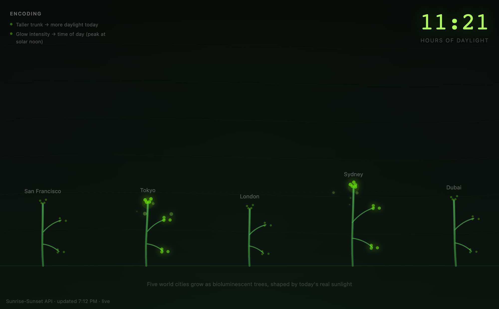
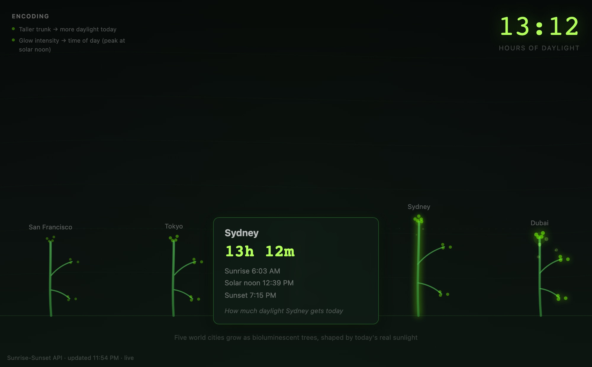

<div align="center">

<h1>grove</h1>

<p><b>Five cities, grown as glowing trees.</b></p>

<p><i>Each tree's height comes from how much daylight that city gets today, and it glows while the sun is up there.</i></p>

<h6>


</h6>

<a href="https://parthchandak02.github.io/grove/"><b>Live demo</b></a> ·
<a href="#how-it-works"><b>How it works</b></a> ·
<a href="#tap-a-tree"><b>Tap a tree</b></a> ·
<a href="#run-it"><b>Run it</b></a>

<br><br>

<a href="https://parthchandak02.github.io/grove/"></a>

<sub>Live capture, 22 October 2026, evening in California. Real sunlight data; the stamp bottom-left reads <code>live</code>.</sub>

</div>

<br>

San Francisco, Tokyo, London, Sydney and Dubai each get one tree. On load the page asks the
[Sunrise-Sunset API](https://sunrise-sunset.org/api) for today's sunrise, sunset, solar noon
and day length at each city, and draws the trees from those numbers alone: no random values.
Cities where the sun is currently up glow brighter and gather more drifting light particles, so
the forest's bright spot moves around the world through the day. The big number top-right is
the average day length across all five. No API key is needed.

## How it works

| Sunrise-Sunset field | Drives |
|---|---|
| `day_length` | Trunk height: 8 h maps to 80 px, 16 h to 200 px |
| `sunset` minus `sunrise` | Branch count: 12 h gives 2 branches, 16 h gives 6 |
| `solar_noon` | Trunk lean, -5° to +5°, read as a clock time in the city's own timezone |
| Time now, between sunrise and sunset | Glow and particle count: dim at night, brightest at solar noon |

Trees sway on a slow sine wave and pulse once each on first load. Until the API answers, the
page draws trees from built-in typical day lengths and the stamp says `fallback`; it switches
to `live` only when all five cities return.

## Tap a tree

<div align="center">



<sub>The panel after tapping Sydney. Live data; times are shown in the city's own timezone.</sub>

</div>

Click or tap a tree to see its city's day length, sunrise, solar noon and sunset, and to put
its day length in the big number. The panel fades after three seconds. Click empty ground to
go back to the five-city average.

## Run it

```bash
git clone https://github.com/parthchandak02/grove.git
cd grove
python3 -m http.server 8000   # then open http://localhost:8000
```

One HTML file with no build step and no libraries. Cities, mapping ranges and colours live in
the `C`, `PALETTE` and `CITIES` objects at the top of the script; [brief.md](brief.md) is the
original creative brief with the full data-to-visual encoding.

<br>

<div align="center">
<sub>Built with Canvas 2D in a single HTML file. Data from sunrise-sunset.org.</sub>
</div>
